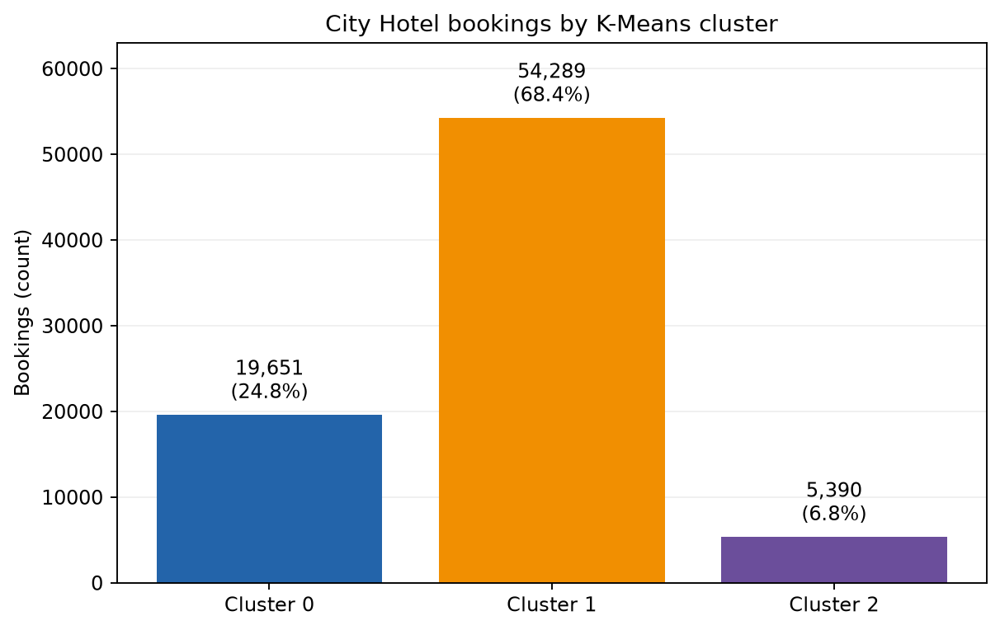
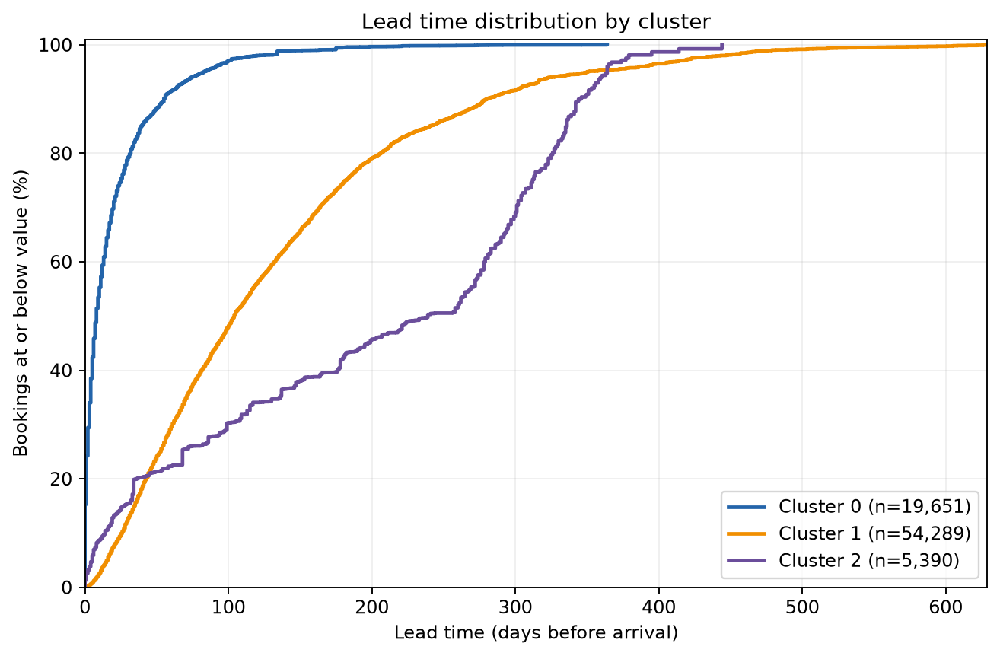
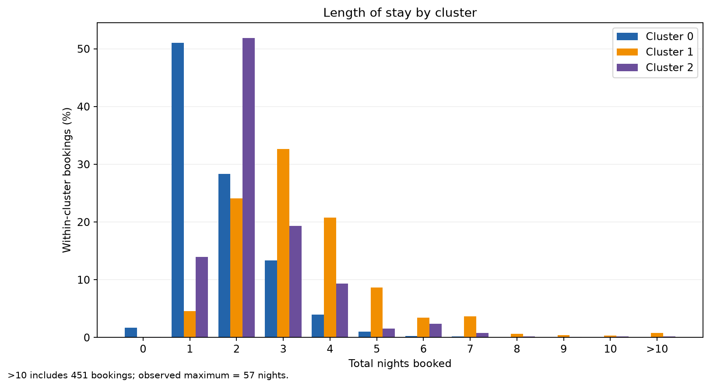
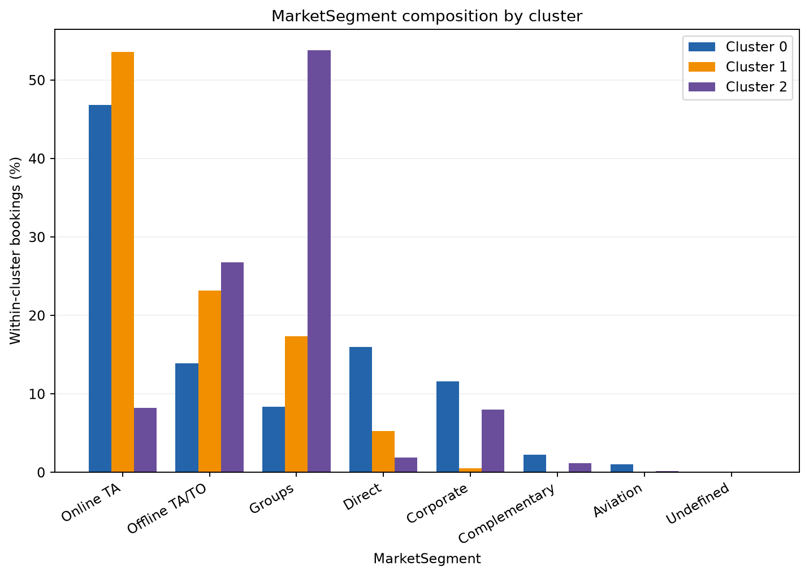
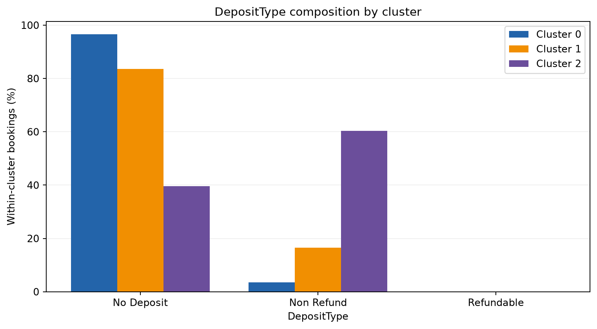
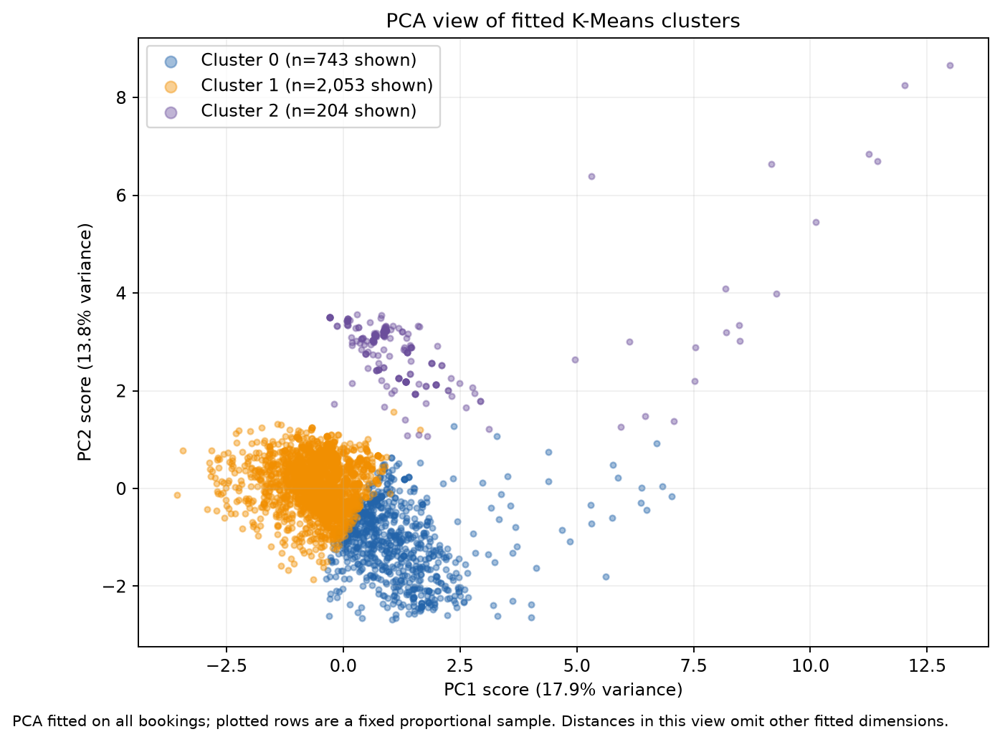

# Member 5 Clustering Contribution: Corrected Milestone 1 Baseline

## What changed

Independent review found that `DepositType` is an outcome-proxy risk. The source publication verifies that it is calculated from payments observed before arrival or cancellation, so it is post-booking and has an outcome-conditioned observation window. `Non Refund` is also very strongly associated with cancellation in H2. The correction removes it from fitting while retaining the original field for post-fit descriptions.

The original 48-feature baseline remains in Git history at `6ba6e29`. All results in this report belong to the revised 45-feature baseline; no old label, count, inertia, metric, or PCA value was reused.

## Data and exact features

The official H2 file has 79,330 rows, 31 columns, and SHA-256 `6796f5b9b2b9e7281662b29730fc2880f8e614107d0d14d09be2ede1a6e605a4`. All rows are preserved.

The 15 fitting fields are `LeadTime`, `TotalNights`, `PreviousCancellations`, `PreviousBookingsNotCanceled`, `WeekendShare`, `PartySize`, `ArrivalDateMonth`, `Meal`, `MarketSegment`, `DistributionChannel`, `IsRepeatedGuest`, `ReservedRoomType`, `CustomerType`, `HasChildren`, and `HasBabies`. Preprocessing creates a finite 79,330 × 45 CSR matrix.

Direct outcomes excluded from fitting are `IsCanceled`, `ReservationStatus`, and `ReservationStatusDate`. Verified later or outcome-conditioned exclusions include `DepositType`, `BookingChanges`, `DaysInWaitingList`, transaction-derived `ADR`, and operational `AssignedRoomType`. Full evidence, conservative exclusions, and selected fields that may reflect lifecycle updates are in [the clustering design](clustering_design.md).

## Fixed revised result

`KMeans(n_clusters=3, init='k-means++', n_init=10, random_state=42, max_iter=300)` converged without warnings in 31 iterations. Inertia is **575,905.1184983611**.

| Cluster | Bookings | Share |
| ---: | ---: | ---: |
| 0 | 19,651 | 24.77% |
| 1 | 54,289 | 68.43% |
| 2 | 5,390 | 6.79% |

The fixed 3,000-row stratified sample contains 743 / 2,053 / 204 rows from clusters 0 / 1 / 2. Its **Silhouette Score is 0.1849722777**. The **Davies-Bouldin Index is 2.0046722671** on all 79,330 rows. These metrics describe this baseline; they do not establish that three clusters are optimal.



## Booking patterns

- **Cluster 0 - short lead and short stay:** median lead time 8 days, median stay 1 night, Online TA 46.86%, Direct market segment 15.98%, and 326 zero-night records.
- **Cluster 1 - dominant advance-planning group:** median lead time 104 days, median stay 3 nights, median weekend share 0.25, Online TA 53.59%, and TA/TO channel 93.59%.
- **Cluster 2 - small long-lead history/group segment:** median lead time 239 days, median stay 2 nights, Groups 53.78%, repeated guests 13.77%, and median previous cancellations 1.





The length-of-stay plot retains the full observed range through an explicit `>10` tail; 451 bookings are in that tail and the maximum is 57 nights.





The deposit chart is deliberately post-fit. Cluster 2 is 60.41% `Non Refund`, but `DepositType` was not present when any cluster was learned. That association must not be interpreted as a cause or as model optimization with cancellation information.

## PCA view

Centered PCA was fitted to all 79,330 rows of the exact 45-feature matrix. K-Means was not refitted in PCA space. PC1 explains **17.9189%**, PC2 explains **13.8004%**, and together they explain **31.7193%**. The plotted 3,000-row proportional sample contains 743 / 2,053 / 204 rows from clusters 0 / 1 / 2.



The plot omits 68.28% of fitted-space variance, so visual overlap or separation in two dimensions cannot prove cluster quality.

## Reproduction

```powershell
python --version  # exact recorded environment: Python 3.14.7
python -m pip install -r requirements.txt -c constraints/clustering-milestone1.txt
python -m src.clustering.experiment --dataset data/H2.csv --output-dir outputs/clustering
python -m src.clustering.evaluation --dataset data/H2.csv --output-dir outputs/clustering --sample-size 3000 --seed 42
python -m src.clustering.visualization --dataset data/H2.csv --output-dir outputs/clustering --sample-size 3000 --seed 42
python -m pytest -q
```

The runners validate schema, row count, checksum, finite matrices, stored baseline consistency, label alignment, and bounded metric memory before writing official outputs. The official path is anchored to the repository independently of process CWD. Alternate datasets require explicit opt-in and a directory outside the official output tree. Numerical outputs are deterministic in the constrained recorded environment; timing fields remain machine- and load-dependent.

## Integration status and limitations

The fetched `origin/main` at `17118fbd5f7cb6d361415d2d612f4312ccf39344` contains Member 2's clustering export, which removes 168 official rows and uses a different feature set and representation, including `ADR` and waiting-list information. The recommended boundary is that Member 2 owns a shared ordered H2 loader with schema/dataset checks and agreed safe normalization, but no row deletion or task-specific features; Member 5 owns all clustering-specific selection, engineering, preprocessing, K-Means, evaluation, and visualization. The normalized 79,330-row source frame would be passed to Member 5's builder. This canonical interface remains **pending explicit team approval**; no Member 2 file was changed.

Separately, the same `origin/main` tracks `Classification.zip`, which contains train/validation/test CSVs and three fitted `.joblib` models. This is a team-level integration blocker outside Member 5's changes. The repository coordinator should remove the archive from tracked `main`, retain only source/report/aggregate outputs, and prevent submission archives from bypassing dataset/model ignore rules.

The publication defines H2 as a retrospective day-prior-to-arrival/change-log snapshot. Selected party, night, meal, reserved-room, arrival-month, market, channel, and customer-type values can reflect lifecycle updates, so these are published-record segments rather than initial-booking customer segments. Other limitations are overlapping market/channel and guest-history fields, Euclidean feature weighting, the sampled silhouette, and the small cluster 2. Alternative cluster counts, stability analysis, tuning, and additional algorithms remain Milestone 2 work and were not added in this correction.

## Consolidated Milestone 1 summary

**Member 5 - clustering.** The corrected full-data K-Means baseline excludes `DepositType` as a verified post-booking, outcome-conditioned proxy while retaining it for post-fit description. The 79,330 × 45 matrix produced clusters of 19,651 (24.77%), 54,289 (68.43%), and 5,390 (6.79%) bookings. Inertia was 575,905.1185 after 31 iterations. A reproducible 3,000-row stratified sample gave silhouette 0.1850, and full-data Davies-Bouldin was 2.0047. Profiles describe a short-lead/short-stay group, a dominant advance-planning group, and a small long-lead history/group segment. Two PCA components explain 31.72% of fitted variance. These are preliminary untuned segments, not an optimized final model.
