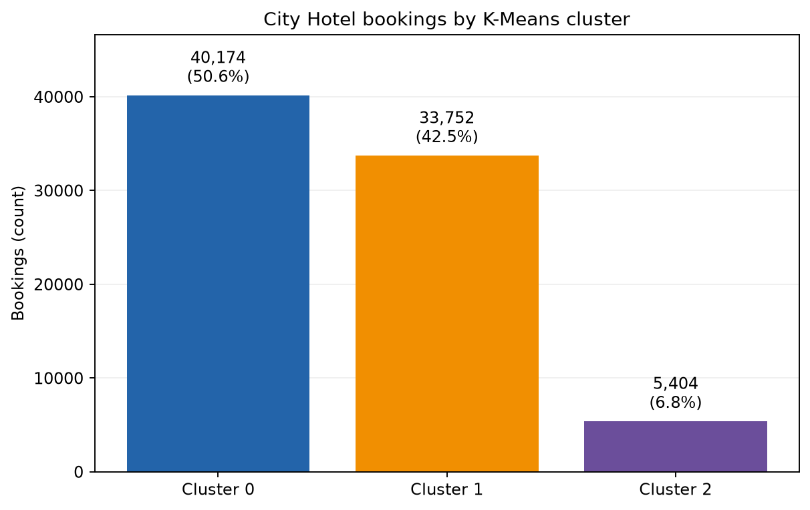
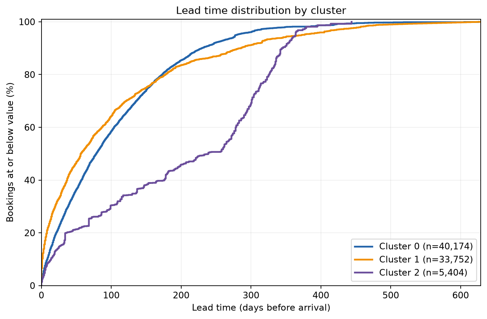
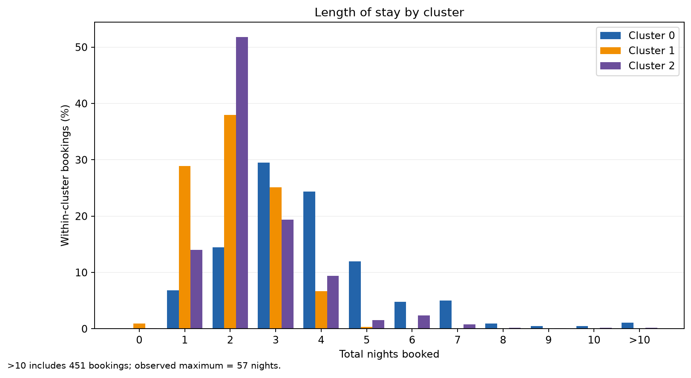
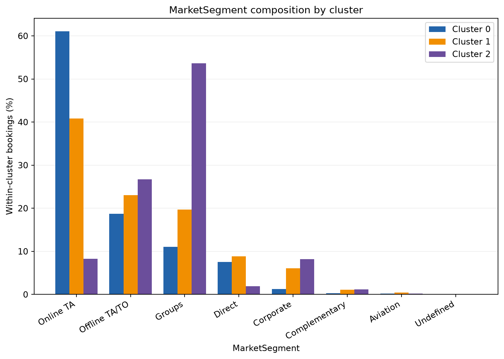
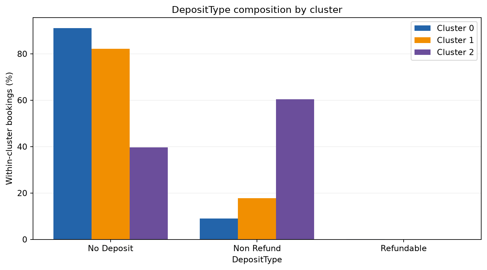
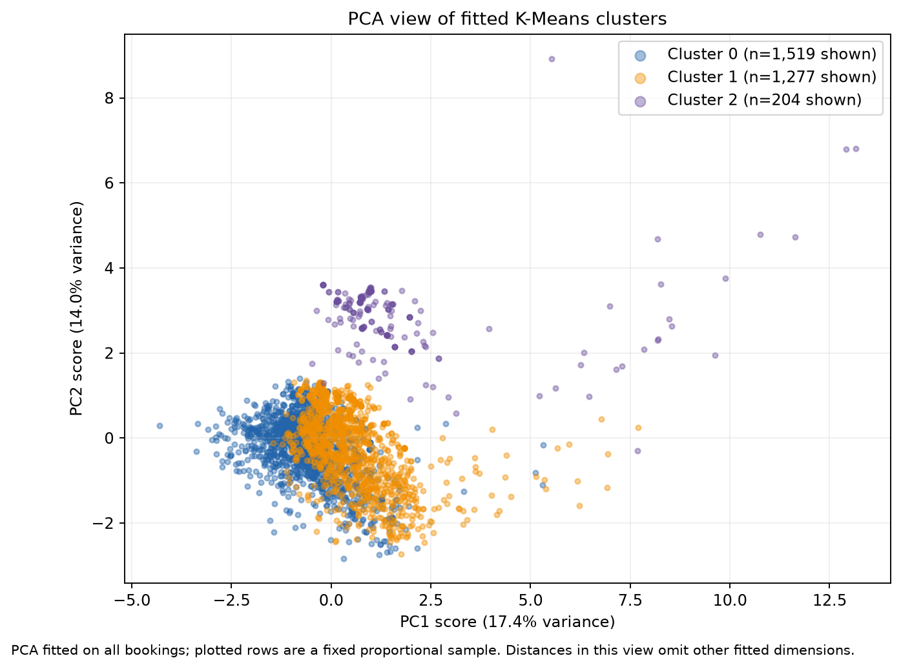

# Member 5 clustering contribution: Milestone 1

## Objective and analysis point

Group City Hotel bookings by characteristics intended to be known when a booking is first recorded. The groups are discovered without supplying `IsCanceled`, `ADR`, or another outcome. They describe booking patterns, not customer identities, reasons for behavior, or future outcomes. This is the fixed, untuned Milestone 1 baseline; it is not a selected final model.

The official project specification, Section 10, requires justified source variables, handling of categorical data and distance scales, internal metrics, a two-dimensional cluster view, and interpretation. Section 16 requires a leakage audit at the stated analysis point. Section 18 asks Milestone 1 for verified H2 data, preprocessing, an initial clustering experiment, preliminary metrics and interpretation, and a progress contribution. The three-algorithm comparison, systematic tuning, and hierarchical dendrogram belong to the complete Milestone 2 work.

## Data, features, and preprocessing

`data/H2.csv` contains 79,330 rows and the expected 31 source columns. Its SHA-256 is `6796f5b9b2b9e7281662b29730fc2880f8e614107d0d14d09be2ede1a6e605a4`. The raw data is ignored by Git. No duplicate or unusual booking was silently removed; all 79,330 rows received labels.

The approved source allowlist contains `LeadTime`, `ArrivalDateMonth`, `StaysInWeekendNights`, `StaysInWeekNights`, `Adults`, `Children`, `Babies`, `Meal`, `MarketSegment`, `DistributionChannel`, `IsRepeatedGuest`, `PreviousCancellations`, `PreviousBookingsNotCanceled`, `ReservedRoomType`, `DepositType`, and `CustomerType`. Fixed engineering creates `TotalNights`, `WeekendShare`, `PartySize`, `HasChildren`, and `HasBabies`, yielding 16 engineered fitting fields. The fitted preprocessing produces 48 columns.

Missing numerical values use median imputation. Nonnegative skewed counts (`LeadTime`, `TotalNights`, and prior booking counts) receive `log1p` and numerical fields are standardized. Missing categories get an explicit marker, then one-hot encoding with unknown levels ignored. Arrival month is encoded as sine/cosine plus a missing marker. Individual dummy columns are not standardized. These steps give K-Means numerical distances, but the relative weight of a category versus a scaled number is a modeling choice and needs later sensitivity analysis.

The fitting input excludes `IsCanceled`, `ADR`, `ReservationStatus`, `ReservationStatusDate`, `AssignedRoomType`, `BookingChanges`, and `DaysInWaitingList` because they are outcomes or may reflect later events. Other excluded fields and reasons are in [the clustering design](clustering_design.md). `PreviousCancellations` and `PreviousBookingsNotCanceled` are interpreted as *past* history; their precise availability at initial booking needs confirmation with the team. Original booking-scale values are retained only for descriptive figures and profiles. PCA uses the already fitted 48-feature representation, without outcome columns or labels in its fit.

## Fixed K-Means result

The baseline is `KMeans(n_clusters=3, init='k-means++', n_init=10, random_state=42, max_iter=300)`. It ran for 15 iterations with no convergence warning. Its inertia is **597,856.3237440714**. Inertia is the sum of squared distances from bookings to their assigned centroids; it is not an accuracy percentage and by itself cannot identify the best `k`.

| Cluster | Bookings | Share |
| ---: | ---: | ---: |
| 0 | 40,174 | 50.64% |
| 1 | 33,752 | 42.55% |
| 2 | 5,404 | 6.81% |

The **Silhouette Score is 0.1213919294**, computed on a fixed proportional stratified sample of 3,000 bookings (1,519 / 1,277 / 204 from clusters 0 / 1 / 2; seed 42). The **Davies-Bouldin Index is 2.1907288369**, computed on all 79,330 rows. Both use the same 48-feature distance space as the K-Means fit. The modest positive silhouette indicates weak average separation in this sample. These values describe this fixed configuration; they do not establish that three clusters are optimal.



## Booking patterns in original units

Cluster 0 has a median lead time of **79 days** and **3 nights**; its median weekend share is **0.40**. `Online TA` accounts for **61.03%**, and `No Deposit` for **91.02%**. The figures show a larger share of three- and four-night stays than the other groups.

Cluster 1 has a median lead time of **57 days**, **2 nights**, and a median weekend share of **0**. Its bookings tend to be shorter, and the group contains **326 zero-night bookings**. `Online TA` is **40.84%**, and `No Deposit` is **82.17%**. The curves overlap with cluster 0, so these are tendencies rather than rigid rules.

Cluster 2 is the smallest group. Its median lead time is **239 days**, with **2 nights** and median weekend share **0**. `Groups` represents **53.65%** of this cluster versus **17.62%** overall. `Non Refund` represents **60.34%** of this cluster; **13.82%** are marked repeated guests. Its median previous cancellations count is **1**. This is a booking-characteristics association, not evidence that the segment causes cancellations.



The lead-time plot is an empirical cumulative distribution: at a given day value, the vertical position is the percentage of bookings made that many days ahead or less. It uses the full observed 0–629 day range and all bookings.



The stay-length bars use within-cluster percentages and original nights. Values above 10 nights appear in a separate tail bar: **451 bookings** fall there, and the observed maximum is **57 nights**. The tail is shown rather than discarded.



The market bars compare percentages *within each cluster*. The larger `Groups` proportion in cluster 2 and larger `Online TA` proportion in cluster 0 are visible; rare categories remain plotted and have small bars.



Cluster 2 has a substantially larger `Non Refund` share than clusters 0 and 1. The chart uses booking-time `DepositType` as recorded in H2; whether every row reflects its initial value remains a dataset-timing limitation.

For exact original-scale quartiles and every categorical count, share, and lift, see `outputs/clustering/cluster_profiles.csv` and `outputs/clustering/cluster_category_profiles.csv`. These figures are descriptive; they do not change the clustering fit.

## PCA view and its limits

Centered **PCA**, using a deterministic randomized solver with seed 42, was fitted to all **79,330 × 48** rows of the exact scaled and encoded matrix used by K-Means. It did not refit K-Means, use supervised LDA, or use `IsCanceled` or `ADR`. The sparse CSR matrix was converted to dense for centered PCA after checking that its estimated **30,462,720-byte (29.05 MiB)** dense input was below a 64 MiB input-array limit. Total process memory can be higher because PCA and plotting allocate temporary arrays.

PC1 explains **17.4089%** and PC2 **13.9882%** of input variance, **31.3970%** together. The scatter shows a deterministic proportional stratified sample of **3,000** fitted bookings, selected without replacement using seed 42; the displayed cluster counts are **1,519 / 1,277 / 204**. PCA scores were computed for all rows before sampling the points shown. The cluster colors come from the original fitted K-Means labels. The visible overlap, especially between clusters 0 and 1, is consistent with the modest silhouette, but this projection drops about 68.60% of fitted-space variance and cannot prove cluster quality or reproduce all 48-dimensional distances.



Figure input and sampling provenance is recorded in `outputs/clustering/visualization_metadata.json`. No row-level labels, raw data, or serialized model are stored in the output directory.

## Reproduction and checks

Run these commands from the repository root after installing `requirements.txt` and placing the verified H2 file at `data/H2.csv`:

```powershell
python -m src.clustering.experiment --dataset data/H2.csv --output-dir outputs/clustering
python -m src.clustering.evaluation --dataset data/H2.csv --output-dir outputs/clustering --sample-size 3000 --seed 42
python -m src.clustering.visualization --dataset data/H2.csv --output-dir outputs/clustering --sample-size 3000 --seed 42
python -m pytest -q
```

The visualization command re-runs the fixed baseline in memory, checks the dataset checksum, parameters, counts, iterations, and inertia against the committed baseline, then checks the Silhouette and Davies-Bouldin values against Phase 4 before writing figures. The small outputs are deterministic for the same dataset and package environment. It does not save a fitted model. Current numerical package versions are in `outputs/clustering/baseline_metadata.json`.

## Leakage audit, limitations, and team dependencies

- The booking-time interpretation of some H2 fields, particularly prior guest history and deposit state, should be reviewed with Member 1's EDA and the team's data dictionary. An H2 row may reflect later updates rather than a clean initial snapshot.
- Member 1 owns the broader EDA decision on duplicates, missing fields, zero-person bookings, zero-night stays, and extreme values. This baseline keeps unusual rows visible. Member 2 owns shared preprocessing and supervised split rules; the clustering modules use their own approved feature contract.
- Euclidean distance can change materially with numerical scaling, one-hot feature weighting, overlapping market/channel information, and skewed history fields. Cluster 2's small size also warrants stability checks.
- The sampled silhouette is an estimate, and the PCA picture is a two-dimensional view of a 48-dimensional fit. Neither establishes an optimal cluster count or generalization.

## Text for the team's consolidated Milestone 1 report

**Member 5 — clustering.** We verified the 79,330-row City Hotel H2 dataset and built a leakage-aware booking-characteristics pipeline with 16 engineered fields and 48 transformed K-Means inputs. The untuned, full-data `k=3` baseline used `k-means++`, 10 initializations, and seed 42. It produced clusters of 40,174 (50.64%), 33,752 (42.55%), and 5,404 (6.81%) bookings; inertia was 597,856.32. A fixed 3,000-row stratified sample gave Silhouette Score 0.1214, and the full-data Davies-Bouldin Index was 2.1907. Original-scale profiles show a longer, more weekend-oriented cluster 0; a shorter, mostly weekday cluster 1; and a smaller cluster 2 with longer lead times and larger `Groups` and `Non Refund` shares. A two-PC view explains 31.40% of fitted-feature variance and shows overlap, so these are preliminary segments rather than validated optimal clusters. Outcome and later-status fields were excluded from fitting. Member 1's EDA and field-timing review remain dependencies.

## Milestone 2 plan (future work)

Compare **at least three** justified clustering algorithms, each in baseline and systematically optimized configurations using unsupervised criteria. Search sensible cluster counts and relevant parameters, report search spaces and selection criteria, test stability across seeds or samples, and compare interpretable profiles and runtime. For hierarchical clustering, use a documented representative sample if the full 79,330-row fit is impractical and produce a dendrogram where practical. Revisit category distance weighting and booking-time field availability. Keep outcome variables out of clustering selection and explain final algorithm choice with the same evaluation protocol.
